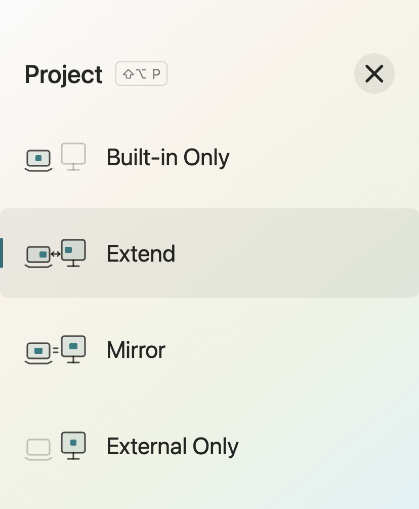

# macDisplayCtl

<div align="center">

**Switch macOS display modes from a native panel or the command line.**

English | [Simplified Chinese](README_CN.md) | [Japanese](README_JA.md)


</div>

macDisplayCtl is a macOS display utility with a native SwiftUI/AppKit app, **macDisplayCtl.app**, and a command-line tool, `macDisplayCtl`. It provides four projection modes, individual display controls, and a background monitor that restores the built-in display when external displays disconnect. The app enables it by default on first launch.

## Screenshots



## Features

- Switch between built-in only, mirror, extend, and external only modes.
- Remember display positions and the main display when returning to extend mode.
- Extend or mirror across all physical external displays.
- Open the translucent panel from the menu bar or with **Ctrl + Shift + P**.
- Enable, disable, or toggle displays by type or ID from the command line.
- Preview changes with `--dry-run` and list displays as JSON for scripts.
- Protect the last enabled non-virtual display from being disabled by default.
- Restore the built-in display after external displays disconnect, then restore its previous state after reconnection.
- Automatically enable recovery and launch at login on first app launch; the monitor runs independently of the app.

The app, command-line tool, and monitor messages follow the system language: Chinese uses a Simplified Chinese interface, and other languages use English. The app is named **macDisplayCtl** in English. Documentation is available in English, Simplified Chinese, and Japanese.

## Requirements

- macOS 13 Ventura or later. Display control depends on private system APIs and varies by macOS version and hardware.
- Xcode or Xcode Command Line Tools with Clang and Swift to build from source.
- Python 3 is needed only to run the development verification suite. The downloaded app and background recovery do not require Python.

The built app bundles the compiled command-line helper and can run without the source checkout. The build script uses ad-hoc signing; it does not perform Developer ID notarization.

## Download

Download the [Universal app for Apple Silicon and Intel](https://github.com/kevin808/macDisplayCtl/releases/download/continuous/macDisplayCtl-universal.zip), unzip it, and move `macDisplayCtl.app` to `/Applications`. No compilation is required. This link follows the latest successful `main` build; versioned releases are available on the [Releases page](https://github.com/kevin808/macDisplayCtl/releases).

The app uses ad-hoc signing and is not notarized. If blocked by macOS, allow it in **System Settings > Privacy & Security**. Background recovery works without installing Python or developer tools.

GitHub Actions builds and tests every pull request and push to `main`. Successful `main` builds update the downloadable development release; pushing a `v*` tag publishes a versioned release. Downloads include `SHA256SUMS.txt` for verification.

## Build from source

```sh
git clone https://github.com/kevin808/macDisplayCtl.git
cd macDisplayCtl
./build-app.sh
open "build/macDisplayCtl.app"
```

The app is generated at `build/macDisplayCtl.app` and can be copied to `/Applications`. If macOS blocks it, allow it in **System Settings > Privacy & Security**.

For command-line use, the `./macDisplayCtl` launcher compiles the helper on first use and rebuilds it when `macDisplayCtl.m` changes. You can also double-click [`macDisplayCtl.command`](macDisplayCtl.command) for an interactive menu in the same language.

## App usage

The panel initially opens in the upper-right corner. Drag its title area to move it; the position is remembered across launches. If the saved position no longer fits on a screen after a display or resolution change, the panel returns to the upper-right corner.

The app runs without a Dock icon by default. Left-click the menu bar icon to choose **Show Main Window**, **Built-in Only**, **Extend**, **Mirror**, **External Only**, or **Quit**. Right-click has no menu. Press **Ctrl + Shift + P** to open or collapse the panel. While it is open, press `1`, `2`, `3`, or `4` to select a mode.

Global shortcuts **Ctrl + Shift + 1/2/3/4** select Built-in Only, Extend, Mirror, and External Only respectively. The menu displays each shortcut.

| Key | Mode shown in the app | Behavior |
| --- | --- | --- |
| `1` | Built-in Only | Enable the built-in display, exit mirroring, and disable physical external displays. |
| `2` | Extend | Enable the built-in and all physical external displays, exit mirroring, and restore each display’s previous extended arrangement. |
| `3` | Mirror | Enable the built-in and all physical external displays, with every external display mirroring the built-in display. |
| `4` | External Displays Only | Enable all physical external displays, exit mirroring, and disable only the built-in display. |

Mode buttons remain clickable when no external display is connected. Selecting Mirror, Extend, or External Only shows **No external display detected** without attempting a display configuration. The same prompt appears if the external display disconnects during a failed switch. A physically connected display that was disabled by the app can still be enabled again. Display changes refresh the panel automatically, and each switch checks the connection again before applying. A temporary configuration rejection shows a plain-language retry prompt.

The panel does not show a second-screen selector. Extend and Mirror use the built-in and all physical external displays; External Displays Only enables every physical external display and disables only the built-in display. Virtual displays do not participate. Cached, unplugged displays are marked **Disconnected**. If enabling a target fails, currently usable displays remain available. Mirroring resolutions depend on macOS and the displays.

Before switching modes, the app saves the current extended positions and main display for each physical display pair. Returning to Extend restores that arrangement, including vertical positions and offsets. Changes made in macOS Display settings are captured on the next mode switch. Saved arrangements use display UUIDs to survive app restarts and system reboots; if UUIDs are unavailable, numeric IDs are used only within the current boot. With no saved arrangement, the app keeps a valid arrangement supplied by macOS, or places the external display on the right as a fallback. An arrangement lost before this feature was installed must be set again once in macOS Display settings.

Click the desktop or another app to hide the panel automatically. You can also click the large close button in the top-right corner or press **Esc**. Reopen it from the menu bar or with **Ctrl + Shift + P**; **Command + Q** quits the app. The panel contains the four projection modes. Failed operations show an alert. Hiding the panel, quitting the app, or closing the interactive menu does not stop the independent monitor.

On first launch, the app automatically enables **Turn on the built-in screen after external disconnection** and installs the monitor to run at login. Later launches update a running monitor if its helper differs from the bundled helper. After initialization, an explicit `guard stop` is retained; use `guard start` to enable it again.

## Language

The app follows the macOS preferred language, including per-app settings in **System Settings > General > Language & Region > Applications**. Restart the app after changing its language. The application bundle keeps the portable filename `macDisplayCtl.app`; Finder uses its localized display name.

The standalone command-line tool and interactive menu follow the system language. To override it for a command, set `MACDISPLAYCTL_LANGUAGE`:

```sh
MACDISPLAYCTL_LANGUAGE=en ./macDisplayCtl --help
MACDISPLAYCTL_LANGUAGE=zh-Hans ./macDisplayCtl --help
```

## Command-line usage

Run these commands from the repository directory. Replace example numeric IDs with IDs from `list`; they may change after a reboot or reconnection.

```sh
./macDisplayCtl list                         # List displays and IDs
./macDisplayCtl list --json                  # JSON output
./macDisplayCtl off builtin                  # Disable the built-in display
./macDisplayCtl on builtin                   # Enable the built-in display
./macDisplayCtl off external                 # Disable all external displays
./macDisplayCtl on external                  # Enable all external displays
./macDisplayCtl toggle 2                     # Toggle display ID 2
./macDisplayCtl on all                       # Enable all recognized displays
./macDisplayCtl off builtin --dry-run        # Preview without changing displays
./macDisplayCtl project internal             # Built-in only
./macDisplayCtl project duplicate 3          # Mirror to external display ID 3
./macDisplayCtl project extend 3             # Extend to external display ID 3
./macDisplayCtl project external 3           # External display ID 3 only
./macDisplayCtl project extend --dry-run     # Preview the projection plan
./macDisplayCtl --help
```

By default, the tool refuses to disable the last enabled non-virtual display. A display scheduled to be enabled in the same operation does not count as an available fallback. To explicitly allow all displays to be disabled, use `./macDisplayCtl off all --allow-all-off`. Stop the recovery monitor first if all displays should remain disabled; otherwise it can restore the built-in display while the lid is open.

Exit codes: `0` means success, no change needed, or a successful preview; `1` means an API or transaction failure; `2` means invalid arguments or a protection refusal; `3` means the transaction was committed but the expected state was not observed within eight seconds.

## Recovery monitor

```sh
./macDisplayCtl guard status                 # Show monitor status
./macDisplayCtl guard start                  # Install/update, start, and enable at login
./macDisplayCtl guard stop                   # Stop and disable launch at login
./macDisplayCtl watch --dry-run --once        # Inspect displays, lid, and recovery decisions
```

When the last usable non-virtual display disappears and the built-in display is disabled, the monitor waits for that state to persist for about 300ms before temporarily enabling the built-in display. Recovery requires an open lid; a closed or unknown lid state defers recovery.

The no-external-display fallback is enabled by default. Wake and lid-open events clear the previous retry cooldown and refresh physical connection state. If the lid is open, all physical external displays are confirmed disconnected, and the built-in display is still disabled, recovery can proceed despite stale display-sleep flags. A short-lived helper performs the recovery and verifies its result with a fresh WindowServer connection. Closed/unknown lid or unknown connection state does not bypass sleep protection. An already-enabled display in normal standby is not repeatedly awakened. Recovery runs after macOS wakes; the monitor cannot run while the computer is actually asleep.

After a physical external display reconnects and remains stable for at least two seconds, the monitor restores the previous built-in display state. It checks again that a usable physical external display exists before disabling the built-in display. The monitor never disables external displays.

The initial preference is learned while an external display is connected. Later choices are observed while an external display is connected and the lid is open. Temporary recovery does not overwrite that preference. To explicitly keep the built-in display enabled after reconnection, run `./macDisplayCtl on builtin` while disconnected, even if it is already enabled. Changes made through other apps during disconnection cannot reliably be distinguished from automatic system recovery.

The monitor listens for display, sleep/wake, and lid events and checks every five seconds. No-external recovery retries after 200ms, 500ms, and 1s, then enters a fifteen-second cooldown after three failures. Ordinary recovery keeps the longer retry interval. Reconnection restoration retries are at least ten seconds apart. After a long sleep, it waits for stability again. Display changes and the monitor share an operation lock.

No `sudo` or system-wide launch agent is required. After updating the source, run `./macDisplayCtl guard start` to update the installed monitor. Installation keeps `.backup` copies of the previous executable and launch agent configuration.

## Local data and logs

These paths are relative to the current user's home directory:

| Path | Purpose |
| --- | --- |
| `~/Library/Application Support/macDisplayCtl/macDisplayCtl` | Installed background executable |
| `~/Library/Application Support/macDisplayCtl/displays.json` | Display identity cache |
| `~/Library/Application Support/macDisplayCtl/guard-state.json` | Built-in display preference and pending recovery state |
| `~/Library/Application Support/macDisplayCtl/builtin-intent.json` | Explicit built-in display choices made with this tool |
| `~/Library/Application Support/macDisplayCtl/extended-layouts.json` | Saved extended display positions and main display |
| `~/Library/LaunchAgents/local.macDisplayCtl.guard.plist` | User launch agent |
| `~/Library/Logs/macDisplayCtl-guard.log` | Monitor log |

The executable, data directory, log, and launch agent use `macDisplayCtl`. The monitor is associated with the app for macOS background activity. Legacy `displayctl` data is not imported.

The display cache and preferences are valid for the current system boot. Preferences survive monitor restarts and updates, and are learned again after a system reboot. Display UUIDs are used when available to handle numeric ID changes.

A cached display may be physically unplugged. `on all` does not guarantee hardware rediscovery. If a cached target fails, use `list` to find a valid ID and enable that display explicitly.

## Development and verification

```sh
./build-app.sh
./test.sh
```

The test script runs simulated command planning, recovery policy, reconnection memory, and projection planning checks without toggling hardware. When a built app is available, it also runs GUI state decoding checks and verifies the app signature. Shell syntax and Git diff whitespace are checked as well. These checks do not establish compatibility with every display or Mac model.

| File | Purpose |
| --- | --- |
| [`macDisplayCtl.m`](macDisplayCtl.m) | Objective-C display control, monitor, and planning tests |
| [`macDisplayCtl`](macDisplayCtl) | Automatic compilation launcher |
| [`macDisplayCtl-guard`](macDisplayCtl-guard) | User launch agent management |
| [`App/macDisplayCtl.swift`](App/macDisplayCtl.swift) | SwiftUI/AppKit panel |
| [`App/Localization.swift`](App/Localization.swift), [`App/Resources`](App/Resources) | Language selection and localized app resources |
| [`tests/localization.py`](tests/localization.py) | Translation and CLI language regression checks |
| [`App/MakeIcon.swift`](App/MakeIcon.swift) | App icon generation |
| [`App/Info.plist`](App/Info.plist) | App metadata |
| [`build-app.sh`](build-app.sh) | App build and ad-hoc signing |
| [`test.sh`](test.sh) | Verification entry point |

## Limitations

- Display enable/disable removes or restores a display in the macOS layout; it is not a DDC hardware power command.
- The tool uses the private `CGSConfigureDisplayEnabled` API. Intel Macs, some M3 built-in displays, and certain virtual or third-party display solutions may not support disabling or reconnecting displays correctly.
- Projection modes require a built-in display. Virtual display detection depends on flags reported by macOS.
- Changes apply to the current login session rather than permanent display configuration. The tool checks transaction return codes and verifies the resulting state through a fresh read-only helper process for up to eight seconds; failed configuration transactions are cancelled.
- Other display-management software may override changes. The monitor retries according to its cooldown policy.

When reporting an issue, include the macOS version, Mac model, display connection type, the command or projection mode used, and relevant log output.
