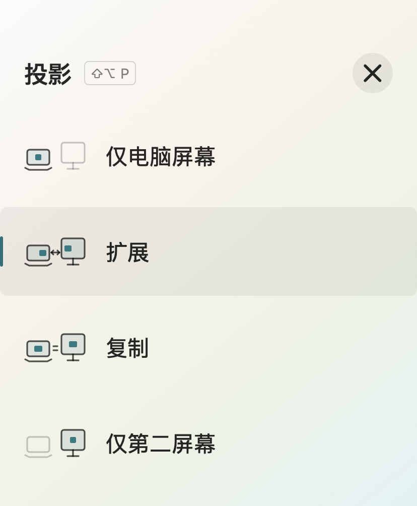

# macDisplayCtl

<div align="center">

**通过原生面板或命令行切换 macOS 显示模式。**

[English](README.md) | 简体中文 | [日本語](README_JA.md)


</div>

macDisplayCtl 是一个 macOS 显示器管理工具，提供原生 SwiftUI/AppKit 应用 **屏幕切换**（`macDisplayCtl.app`） 和命令行工具 `macDisplayCtl`。支持四种投影模式、单独启停显示器，以及在外屏断开时恢复内置屏的后台监控。应用首次启动时默认启用此功能。

## 应用截图



## 主要功能

- 在仅内置屏、复制、扩展、仅外置屏四种模式之间切换。
- 切回扩展时恢复原来的屏幕排列和主屏幕。
- 选择参与投影的实体外置显示器。
- 通过菜单栏图标或 **Shift + Option + P** 打开半透明面板。
- 通过命令行按类型或 ID 启用、停用或切换显示器。
- 使用 `--dry-run` 预览操作，或输出 JSON 显示器列表供脚本使用。
- 默认保护最后一块已启用的非虚拟屏，避免误操作导致无屏幕可用。
- 外屏断开后临时恢复内置屏，重新接入后恢复此前的内屏状态。
- 首次启动应用时自动开启恢复功能与登录启动，后台监控独立于应用运行。

应用、命令行和监控提示默认跟随系统语言：中文使用简体中文，其他语言使用英文。中文应用名为“屏幕切换”，英文为“macDisplayCtl”。项目文档提供英文、简体中文和日文版本。

## 系统要求

- macOS 13 Ventura 或更高版本。显示控制依赖私有系统接口，兼容性取决于 macOS 版本和硬件。
- 从源码构建需要 Xcode 或包含 Clang、Swift 的 Xcode Command Line Tools。
- 安装、更新、启动后台监控及运行验证套件需要可通过 `python3` 调用的 Python 3。

构建后的应用内置已编译的命令行核心，运行时无需保留源码目录。构建脚本使用 ad-hoc 签名，不执行 Developer ID 公证。

## 下载使用

下载 [Apple Silicon / Intel 通用版应用](https://github.com/kevin808/macDisplayCtl/releases/download/continuous/macDisplayCtl-universal.zip)，解压后将 `macDisplayCtl.app` 拖到“应用程序”即可，无需自行编译。此链接提供 `main` 分支最新成功构建的开发版；版本发布可在 [Releases 页面](https://github.com/kevin808/macDisplayCtl/releases)查看。

应用使用 ad-hoc 签名，尚未进行 Apple 公证。若 macOS 阻止打开，请在**系统设置 > 隐私与安全性**中允许打开。后台自动恢复功能需要 `python3`。

GitHub Actions 会在 PR 和推送到 `main` 时自动构建并测试；`main` 构建成功后更新开发版下载，推送 `v*` 标签时发布对应版本。下载页面同时提供 `SHA256SUMS.txt` 校验文件。

## 从源码构建

```sh
git clone https://github.com/kevin808/macDisplayCtl.git
cd macDisplayCtl
./build-app.sh
open "build/macDisplayCtl.app"
```

应用生成在 `build/macDisplayCtl.app`，可复制到 `/Applications`。如果 macOS 阻止打开，可前往**系统设置 > 隐私与安全性**允许打开。

命令行入口 `./macDisplayCtl` 会在首次使用时自动编译，并在 `macDisplayCtl.m` 更新后重新构建。也可以双击 [`macDisplayCtl.command`](macDisplayCtl.command)，通过跟随系统语言的交互菜单操作。

## 应用使用方法

应用默认不显示 Dock（程序坞）图标。左键点击菜单栏图标，可选择“显示主界面”、“仅电脑屏幕”、“扩展”、“复制”、“仅第二屏幕”或“退出”；右键不再显示菜单。按 **Shift + Option + P** 打开/收起面板。面板打开时，按 `1`、`2`、`3`、`4` 选择对应模式。

全局快捷键 **Shift + Option + 1/2/3/4** 分别对应仅电脑屏幕、扩展、复制、仅第二屏幕，菜单中也会显示对应快捷键。

| 按键 | 模式 | 行为 |
| --- | --- | --- |
| `1` | 仅电脑屏幕 | 启用内置屏，退出镜像并停用实体外置屏。 |
| `2` | 扩展 | 启用两块屏幕，退出镜像，恢复之前的扩展排列。 |
| `3` | 复制 | 启用内置屏与所选外屏，外屏镜像内置屏。 |
| `4` | 仅第二屏幕 | 先启用并确认所选外屏，再退出镜像、停用内置屏。 |

没有外接显示器时，模式按钮仍可点击。选择“复制、扩展、仅第二屏幕”时，会提示“未发现外接显示器”，不会尝试提交显示配置；切换失败且发现外屏已断开时，也显示相同提示。仍接着线、只是被应用关闭的外屏可以重新启用。显示器变化会自动刷新面板，每次切换前也会重新检查连接；系统暂时拒绝配置时，显示易懂的稍候重试提示。

只有多个实体外屏目标可选时，标题下方才显示“第二屏幕”选项；仅有一块外屏时自动选用。投影模式使用内屏与这块外屏，其余已启用实体外屏会停用；虚拟屏不参与切换。已拔线的缓存外屏标为**待连接**，目标启用失败时会保留当前可用屏幕。复制模式的可用分辨率由 macOS 与显示器共同决定。

切换模式前，应用会按实体显示器组合保存当前的扩展位置和主屏幕；切回“扩展”时恢复，包括上下排列和位置偏移。在 macOS 显示器设置中调整排列后，下次切换会记住新排列。记录通过显示器 UUID 匹配，关闭应用或重启系统后仍然保留；无法获取 UUID 时仅在本次系统启动内使用数字 ID 匹配。没有记录时，优先保留 macOS 提供的有效排列，否则才默认将外屏放在右侧。更新前已经丢失的排列，需要先在 macOS 显示器设置中重新调整一次。

点击桌面空白处或其他应用时，面板会自动收起；也可以点击右上角的大号关闭按钮或按 **Esc** 收起。通过菜单栏图标或 **Shift + Option + P** 可以重新打开，**Command + Q** 退出应用。主面板保留四种投影模式，操作失败时通过弹窗提示。收起面板、退出应用或关闭交互菜单都不会停止独立后台监控。

应用首次启动时默认启用“断开外屏后自动点亮内屏”，并安装登录后自动运行的监控。之后打开应用时，若监控正在运行且核心与内置版本不同，会自动更新。完成初始化后，通过 `guard stop` 明确停止的监控会保持关闭，可用 `guard start` 再次启用。

## 语言设置

应用跟随 macOS 首选语言，也支持在**系统设置 > 通用 > 语言与地区 > 应用程序**中单独设置语言。修改后请重新打开应用。应用包的实际文件名统一为 `macDisplayCtl.app`，Finder 使用本地化显示名。

独立命令行工具和交互菜单跟随系统语言，也可通过 `MACDISPLAYCTL_LANGUAGE` 临时指定：

```sh
MACDISPLAYCTL_LANGUAGE=en ./macDisplayCtl --help
MACDISPLAYCTL_LANGUAGE=zh-Hans ./macDisplayCtl --help
```

## 命令行用法

在仓库目录中执行以下命令。数字 ID 仅为示例，请先用 `list` 查询；ID 可能在重启或重新接入后变化。

```sh
./macDisplayCtl list                         # 查看显示器与 ID
./macDisplayCtl list --json                  # 输出 JSON
./macDisplayCtl off builtin                  # 停用内置屏
./macDisplayCtl on builtin                   # 启用内置屏
./macDisplayCtl off external                 # 停用所有外置屏
./macDisplayCtl on external                  # 启用所有外置屏
./macDisplayCtl toggle 2                     # 切换 ID 为 2 的显示器
./macDisplayCtl on all                       # 启用全部可识别显示器
./macDisplayCtl off builtin --dry-run        # 只预览，不改变屏幕
./macDisplayCtl project internal             # 仅电脑屏幕
./macDisplayCtl project duplicate 3          # 与 ID 为 3 的外屏复制
./macDisplayCtl project extend 3             # 与 ID 为 3 的外屏扩展
./macDisplayCtl project external 3           # 仅 ID 为 3 的外屏
./macDisplayCtl project extend --dry-run     # 预览投影计划
./macDisplayCtl --help
```

默认拒绝停用最后一块已启用的非虚拟屏。同一次操作中计划启用的屏幕不作为当前可用的后备屏。确实需要全关时，可显式执行 `./macDisplayCtl off all --allow-all-off`。若要保持所有屏幕停用，请先停止恢复监控，否则监控可能在开盖时恢复内置屏。

返回码：`0` 表示成功、无需改变或预览成功；`1` 表示接口或事务失败；`2` 表示参数无效或操作保护拒绝；`3` 表示事务已提交，但两秒内未观察到预期状态。

## 自动恢复与状态记忆

```sh
./macDisplayCtl guard status                 # 查看监控状态
./macDisplayCtl guard start                  # 安装/更新、启动，并设为登录时启动
./macDisplayCtl guard stop                   # 停止，同时关闭登录自动启动
./macDisplayCtl watch --dry-run --once        # 只读检查屏幕、盖子和恢复决策
```

最后一块可用非虚拟屏消失、内置屏也停用时，监控会等待状态持续至少一秒，再临时启用内置屏。恢复要求笔记本已开盖；合盖或无法读取盖子状态时等待开盖。

实体外屏重新接入并稳定至少两秒后，恢复断开前的内屏状态。恢复内屏停用前会再次确认仍有可用实体外屏。监控不会停用外屏。

初始偏好根据外屏连接时的内屏状态学习，之后在外屏连接且开盖时观察用户的内屏启停选择。断开期间的兜底启用不会覆盖原偏好。若希望接回外屏后保持内屏启用，可在断开期间显式执行 `./macDisplayCtl on builtin`，即使内屏已经启用也有效。断开期间通过其他应用更改状态，无法可靠地区分用户选择与系统自动恢复。

监控监听显示配置与开盖事件，并每五秒补查一次。兜底恢复失败后至少间隔十秒重试，每三次尝试后冷却六十秒；重接状态恢复至少间隔十秒重试。长时间休眠后重新等待状态稳定。显示切换与监控共用操作锁。

无需 `sudo`，也不使用系统级启动项。更新源码后执行 `./macDisplayCtl guard start` 同步更新已安装监控。安装时保留已有程序和启动项配置的 `.backup` 副本。

## 本地数据与日志

以下路径均以当前用户的主目录为起点：

| 路径 | 用途 |
| --- | --- |
| `~/Library/Application Support/macDisplayCtl/macDisplayCtl` | 已安装的后台程序 |
| `~/Library/Application Support/macDisplayCtl/displays.json` | 显示器身份缓存 |
| `~/Library/Application Support/macDisplayCtl/guard-state.json` | 内屏偏好与待恢复状态 |
| `~/Library/Application Support/macDisplayCtl/builtin-intent.json` | 通过本工具明确设置的内屏选择 |
| `~/Library/Application Support/macDisplayCtl/extended-layouts.json` | 扩展排列与主屏幕记忆 |
| `~/Library/LaunchAgents/local.macDisplayCtl.guard.plist` | 用户级启动项 |
| `~/Library/Logs/macDisplayCtl-guard.log` | 后台监控日志 |

后台程序、数据目录、日志和启动项统一使用 `macDisplayCtl`，并关联到应用的 macOS 后台活动。旧版 `displayctl` 数据不会导入。

显示器缓存与状态记忆在本次系统启动期间有效。偏好可在监控重启或更新后继续衔接，系统重启后重新学习；能读取显示器 UUID 时，会用它对应显示器，以适应数字 ID 变化。

缓存中的显示器可能已拔线，`on all` 不保证重新检测到全部硬件。缓存目标启用失败时，请先用 `list` 找到有效 ID，再按 ID 启用。

## 开发与验证

```sh
./build-app.sh
./test.sh
```

测试脚本通过模拟状态验证命令规划、恢复规则、重接记忆和投影规划，不会主动切换实体屏幕。存在已构建应用时，还会运行 GUI 状态解码检查并验证应用签名；同时检查 Shell 语法与 Git diff 空白格式。这些检查不能代替不同显示器或 Mac 机型上的兼容性验证。

| 文件 | 用途 |
| --- | --- |
| [`macDisplayCtl.m`](macDisplayCtl.m) | Objective-C 显示控制、监控与规划测试 |
| [`macDisplayCtl`](macDisplayCtl) | 自动编译入口 |
| [`macDisplayCtl-guard`](macDisplayCtl-guard) | 用户级启动项管理 |
| [`App/macDisplayCtl.swift`](App/macDisplayCtl.swift) | SwiftUI/AppKit 面板 |
| [`App/Localization.swift`](App/Localization.swift)、[`App/Resources`](App/Resources) | 语言选择与应用本地化资源 |
| [`tests/localization.py`](tests/localization.py) | 翻译与命令行语言回归检查 |
| [`App/MakeIcon.swift`](App/MakeIcon.swift) | 应用图标生成 |
| [`App/Info.plist`](App/Info.plist) | 应用元信息 |
| [`build-app.sh`](build-app.sh) | 应用构建与 ad-hoc 签名 |
| [`test.sh`](test.sh) | 验证入口 |

## 已知限制

- 启停操作将显示器从 macOS 布局中移除或恢复，不是 DDC 硬件电源命令。
- 工具使用私有接口 `CGSConfigureDisplayEnabled`。Intel Mac、部分 M3 内置屏，以及某些虚拟或第三方显示方案可能无法正常停用或重连。
- 投影模式需要内置屏。虚拟屏识别取决于 macOS 返回的标记。
- 改变仅作用于当前登录会话，不写永久显示配置。工具检查事务返回码，并在提交后最多等待两秒核对状态；配置失败时取消事务。
- 其他显示管理软件可能覆盖本工具的更改，监控会按冷却规则重试。

反馈问题时，请提供 macOS 版本、Mac 机型、显示器连接方式、执行的命令或投影模式，以及相关日志片段。
